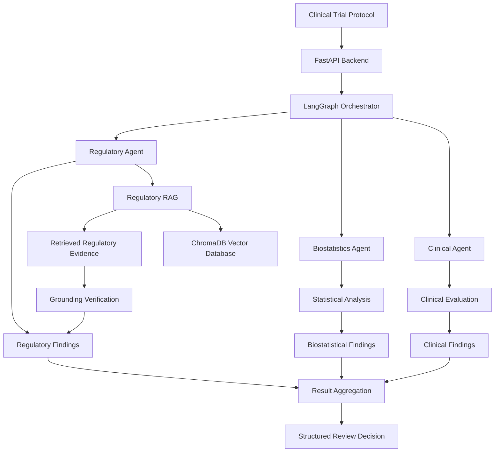

# 🧬 Multi-Agent Clinical Trial Protocol Review System

An AI-powered multi-agent framework for evaluating clinical trial protocols using **Retrieval-Augmented Generation (RAG), Large Language Models (LLMs), LangGraph, and regulatory knowledge bases**.

The system coordinates specialized AI agents to review clinical trial protocols from regulatory, biostatistical, and clinical perspectives, helping identify potential issues and generate structured review findings.

---

## 📌 Project Overview

Clinical trial protocol development requires careful evaluation of regulatory compliance, statistical validity, clinical relevance, patient eligibility, and safety considerations.

Traditional protocol reviews can be time-consuming and require coordination across multiple specialized domains.

This project introduces a **Multi-Agent Clinical Trial Protocol Review System** that uses LangGraph to coordinate specialized AI agents and support structured protocol evaluation.

The system combines:
- Retrieval-Augmented Generation (RAG) for regulatory knowledge retrieval.
- LLM-powered agents for domain-specific protocol analysis.
- Deterministic statistical calculations using Python and Statsmodels.
- Evidence-grounding verification for regulatory explanations.
- Parallel agent execution and structured result aggregation.

## ✨ Key Features

- **Multi-Agent Architecture:** Specialized regulatory, biostatistics, and clinical agents.
- **Regulatory RAG:** Retrieves relevant regulatory information from a locally stored ChromaDB vector database.
- **Evidence-Grounded Verification:** Checks regulatory explanations against retrieved evidence.
- **Statistical Evaluation:** Uses deterministic statistical calculations to assess sample-size and power-related considerations.
- **Clinical Assessment:** Reviews population, eligibility, interventions, comparators, endpoints, and safety monitoring.
- **Parallel Execution:** Runs specialized agents through a LangGraph workflow.
- **Structured Aggregation:** Combines agent findings into an overall protocol review decision.
- **FastAPI Backend:** Exposes the review workflow through API endpoints.

---

## 🏗️ System Architecture

The system follows a multi-agent architecture orchestrated using LangGraph.



### Workflow

1. The user submits clinical trial protocol text through the backend.
2. FastAPI receives the request and initiates the LangGraph workflow.
3. The workflow executes three specialized agents in parallel.
4. The regulatory agent retrieves relevant regulatory evidence using RAG.
5. Regulatory explanations are checked through an evidence-grounding verification step.
6. The biostatistics agent performs statistical evaluation using deterministic calculations.
7. The clinical agent evaluates clinical design and patient-related considerations.
8. The results are aggregated into a structured protocol review decision.

---

## 🤖 Specialized AI Agents

### 1. Regulatory Agent

Evaluates protocol-related regulatory considerations using a Retrieval-Augmented Generation pipeline.

**Responsibilities:**
- Retrieve relevant regulatory information.
- Identify potential regulatory compliance concerns.
- Generate evidence-supported explanations.
- Check findings against retrieved regulatory material.

**Technologies:**
- Google Gemini
- LangChain
- Sentence Transformers
- ChromaDB
- RAG

### 2. Biostatistics Agent

Evaluates statistical considerations relevant to clinical trial design.

**Responsibilities:**
- Assess sample-size-related considerations.
- Evaluate statistical power assumptions.
- Consider expected effect size and variability.
- Generate structured statistical findings.

**Technologies:**
- Python
- Statsmodels
- Statistical methods

**Implementation note:** The current workflow uses predefined demonstration parameters for its statistical calculations. These include sample size, expected effect, standard deviation, significance level, and target statistical power. They are not yet automatically extracted from every submitted protocol.

### 3. Clinical Agent

Reviews clinical design considerations and patient-related aspects of the protocol.

**Responsibilities:**
- Evaluate study population and eligibility criteria.
- Review intervention and comparator descriptions.
- Examine endpoint relevance.
- Identify safety-monitoring considerations.
- Generate structured clinical findings.

---

## 📚 Regulatory Knowledge Base

The regulatory RAG component uses a local vector database to retrieve relevant regulatory information.

The knowledge-base workflow includes source material from:

| Source | Description |
|---|---|
| 21 CFR Part 50 | Protection of Human Subjects |
| 21 CFR Part 56 | Institutional Review Boards |
| 21 CFR Part 312 | Investigational New Drug Application |
| ICH E6(R2) | Good Clinical Practice |
| ICH E8(R1) | General Considerations for Clinical Studies |
| ICH E9 | Statistical Principles for Clinical Trials |
| FDA Guidance | Clinical research and regulatory guidance |
| ClinicalTrials.gov | Clinical trial information |

### RAG Pipeline

1. Regulatory documents are collected.
2. Source documents are processed into text.
3. Text is converted into embeddings.
4. Embeddings are stored in ChromaDB.
5. Relevant information is retrieved during protocol review.
6. The regulatory agent uses retrieved evidence to support its findings.
7. A grounding verification step checks the generated explanations against retrieved evidence.

**Embedding Model:** `sentence-transformers/all-MiniLM-L6-v2`

**Vector Database:** ChromaDB

**Vector Store:** Local `vector_store/` directory.

---

## 🧰 Technology Stack

| Category | Technologies |
|---|---|
| Programming Language | Python |
| LLM | Google Gemini |
| AI Orchestration | LangGraph |
| LLM Framework | LangChain |
| Retrieval-Augmented Generation | RAG |
| Embeddings | Sentence Transformers |
| Vector Database | ChromaDB |
| Statistical Analysis | Statsmodels |
| Backend | FastAPI |
| API Server | Uvicorn |
| Clinical Trial Data | ClinicalTrials.gov |
| Regulatory Sources | FDA, ICH, eCFR |

---

## 📂 Project Structure

```text
MultiAgentClinicalTrial/
│
├── backend/
│   └── api.py
│
├── scripts/
│   └── review_graph.py
│
├── frontened/
│   └── Frontend application files
│
├── vector_store/
│   └── Local ChromaDB vector index
│
├── data/
│   └── Regulatory and clinical trial source data
│
├── .env
├── .gitignore
└── README.md
```

*Note: The vector database is generated and stored locally. The actual vector index may not be included in the GitHub repository.*

---

## ⚙️ Installation and Setup

### Prerequisites

- Python 3.10 or later
- pip
- Google Gemini API key
- Git

### 1. Clone the Repository

```bash
git clone https://github.com/anujp012/MultiAgentClinicalTrial.git
```

```bash
cd MultiAgentClinicalTrial
```

### 2. Create a Virtual Environment

```bash
python -m venv venv
```

Activate the environment.

**Windows:**

```bash
venv\Scripts\activate
```

**Linux / macOS:**

```bash
source venv/bin/activate
```

### 3. Install Dependencies

Install the project dependencies required by the application:

```bash
pip install fastapi uvicorn langgraph langchain langchain-google-genai google-generativeai chromadb sentence-transformers statsmodels python-dotenv
```

### 4. Configure Environment Variables

Create a `.env` file in the project root directory.

```env
GOOGLE_API_KEY=your_google_gemini_api_key
GEMINI_MODEL=gemini-2.5-flash-lite
```

Replace the placeholder with your own API key.

**Security:** Never upload your actual API key or `.env` file to GitHub. Keep secrets private.

---

## 🚀 Running the Application

### Step 1: Prepare the Regulatory Knowledge Base

Ensure the regulatory documents have been collected and processed, and that the ChromaDB vector index has been generated using the project's indexing workflow.

The application expects the required local vector-store data to be available.

### Step 2: Start the FastAPI Backend

From the project root directory, run:

```bash
uvicorn backend.api:app --reload
```

### Step 3: Open the API Documentation

Once the server starts successfully, visit:

```text
http://127.0.0.1:8000/docs
```

FastAPI provides an interactive Swagger interface for exploring and testing the available API endpoints.

---

## 🔌 API Overview

The FastAPI backend provides the interface for interacting with the clinical trial protocol review workflow.

The main workflow accepts protocol text, initiates the multi-agent review process, and returns structured findings.

API documentation is available through the Swagger interface:

```text
http://127.0.0.1:8000/docs
```

The available endpoints and request schemas are defined in `backend/api.py`.

---

## 🔍 Current Implementation Scope

The current implementation demonstrates:

- Multi-agent orchestration using LangGraph.
- Parallel execution of regulatory, biostatistics, and clinical agents.
- Regulatory knowledge retrieval using ChromaDB.
- Evidence-grounding verification for regulatory explanations.
- Deterministic statistical evaluation using Statsmodels.
- Structured aggregation of agent findings.
- FastAPI-based backend integration.

### Current Limitations

The following capabilities are not yet implemented as complete automated workflows:

- Automatic PDF upload and protocol document parsing.
- Automatic extraction of every statistical parameter from submitted protocols.
- Dynamic statistical parameter configuration for each protocol.
- Automatic protocol rewriting and iterative re-review.
- Fully automated end-to-end regulatory approval or compliance certification.

The system is intended as a research and decision-support prototype, not a replacement for qualified clinical, statistical, regulatory, or ethics review.

---

## 🔮 Future Enhancements

Potential future improvements include:

- PDF and DOCX protocol ingestion.
- Automated protocol section extraction.
- Dynamic sample-size and statistical power analysis using protocol-specific parameters.
- Expanded regulatory knowledge bases.
- Improved evidence traceability and citation support.
- Human-in-the-loop review and approval.
- Automated protocol improvement recommendations.
- Iterative protocol revision and re-evaluation.
- Enhanced frontend dashboards.
- Comprehensive evaluation datasets and automated testing.

---

## ⚠️ Responsible Use

This project is designed for research, experimentation, and clinical trial protocol review assistance.

Its outputs should not be interpreted as:
- Regulatory approval.
- Clinical authorization.
- Ethics committee approval.
- Medical advice.
- A substitute for qualified professional review.

All generated findings should be independently validated by appropriate experts before being used in real clinical research decisions.

---

## 👥 Authors

| Author | GitHub Profile |
|---|---|
| **Anuj P.** | [@anujp012](https://github.com/anujp012) |
| **Arjun Talekar** | [@sonaltalekar1203-web](https://github.com/sonaltalekar1203-web) |
| **Mainuddin Sable** | [@Mainuddin-sable](https://github.com/Mainuddin-sable) |

### Contributors

This project was developed collaboratively by the authors listed above.

---

## 🔗 Project Links

- **GitHub Repository:** [MultiAgentClinicalTrial](https://github.com/anujp012/MultiAgentClinicalTrial)
- **Anuj P.:** [GitHub Profile](https://github.com/anujp012)
- **Arjun Talekar:** [GitHub Profile](https://github.com/sonaltalekar1203-web)
- **Mainuddin Sable:** [GitHub Profile](https://github.com/Mainuddin-sable)

---

## 📄 License

No license file is currently specified in the repository. All rights and permissions should therefore be treated as reserved unless a license is added.

---

<p align="center">
  <b>Multi-Agent Clinical Trial Protocol Review System</b><br>
  AI • RAG • LangGraph • Clinical Research
</p>
